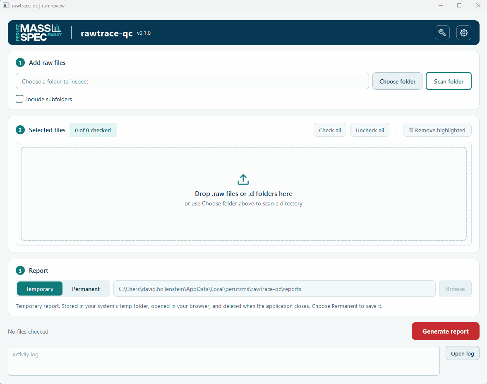
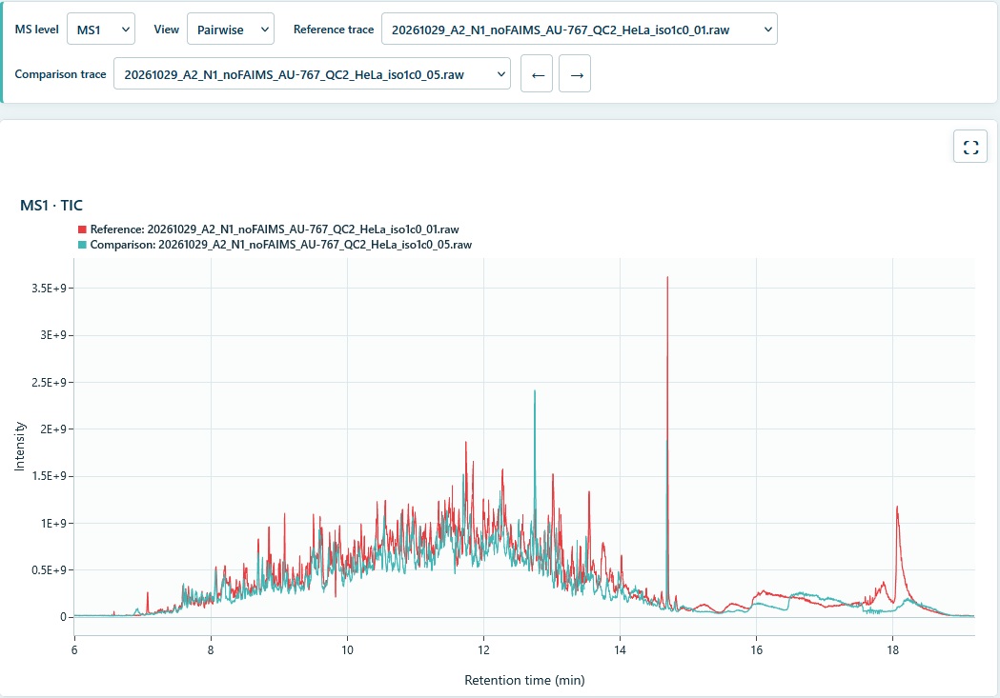

# rawtrace-qc

rawtrace-qc creates interactive HTML reports from mass spectrometry raw files, so that you can compare runs and spot problems in them. You select Thermo `.raw` files or Bruker timsTOF `.d` folders in a desktop application, and the report then opens in your browser.



*This recording uses traces that rawtrace-qc had already extracted and cached. Your first report takes longer because rawtrace-qc must extract the traces first.*

## Install

You need Windows to use the desktop application in this release. We recommend [uv](https://docs.astral.sh/uv/getting-started/installation/) because it installs rawtrace-qc in a separate environment and downloads a suitable Python version if necessary:

```bash
uv tool install "rawtrace-qc[gui]"
```

If you prefer pip, you need Python 3.12 or later:

```bash
pip install "rawtrace-qc[gui]"
```

Then start the application with this command:

```bash
rawtrace-qc-gui
```

## Set up Thermo support

To read `.raw` files, rawtrace-qc uses a separate program from us called the Thermo tool (`ThermoScanHeaderExtractor`). This program has its own license from Thermo, so you install it and accept the license yourself. You can skip this section if you only use Bruker `.d` folders.

1. Click the wrench button at the top right of the application. A dot on this button shows that the setup is not complete.
2. Click **Download**.
3. Click **Show license** to read the terms.
4. Click **Accept license** if you agree to the terms. Your acceptance applies to your user account.
5. Click **Close**.

If your computer has no internet access, use another computer to download the ZIP file that the window names. Then copy the file to your computer and click **Install from ZIP** instead of **Download**.


## Create a report

1. Drag your raw files into the **Selected files** area. Alternatively, click **Choose folder** and then **Scan folder**.
2. Check the files that you want in the report.
3. Select **Temporary** or **Permanent**. The application deletes a temporary report when you close the application, while a permanent report stays in the folder that you choose.
4. Click **Generate report**.

The report opens in your default browser when it is ready. Because rawtrace-qc keeps the extracted traces in a cache, it does not extract the same files again for later reports.

If rawtrace-qc cannot use a file, it marks that file with a red cross and creates the report without it. To see the reason, hold the mouse pointer over the file.

## Read a report

Each report is one HTML file that you can open without a network connection. The report has these tabs:

- **TIC** shows the total ion current.
- **BPC** shows the base peak chromatogram.
- **Metadata** lists one row for each trace.



You can show the traces of the selected MS level in three views:

- **Overlay** draws the selected traces in one plot.
- **Stacked** gives each selected trace its own plot.
- **Pairwise** compares the reference trace with one other trace. Use the arrow buttons or the arrow keys to move to the next trace.

To compare runs against one specific run, select it as the **Reference trace**. The report then draws that run in red, which is the only trace with this color. In the **Metadata** tab, you can click a column header to sort the rows, and the plots then use the same order.

## Limitations

This release has the following limitations, which we will address in upcoming releases:

- **Desktop application:** The desktop application runs only on Windows. We plan to add support for Linux and macOS.
- **Thermo files:** You can read `.raw` files only on Windows for now. Although the Thermo tool itself is cross-platform, rawtrace-qc does not yet use it on other systems.
- **Command line:** The command-line interface cannot create reports yet, although it can extract traces.
- **MS2 traces:** The reports include MS2 traces, but these traces are not very useful yet. We are working on a better way to show MS2 data.
- **FAIMS:** rawtrace-qc splits a FAIMS run into one trace for each compensation voltage (CV). This split is not optimal, and a combined view is not available yet.

## Use the command line

The command-line interface extracts traces in batches and sets up the Thermo tool. Install it with the `cli` option:

```bash
uv tool install "rawtrace-qc[cli]"
```

Use `"rawtrace-qc[cli,gui]"` if you want both interfaces. The same options work with `pip install`.

To set up the Thermo tool, run the commands below. The `accept-license` command prints the terms and records your acceptance in one step, so run it only if you agree to them. To read the terms first, use **Show license** in the desktop application.

```bash
rawtrace-qc thermo install
rawtrace-qc thermo accept-license
rawtrace-qc thermo status
```

The `extract` command then writes the traces of each raw file as Parquet files:

```bash
rawtrace-qc extract sample.raw run.d
rawtrace-qc extract /data/acquisitions --recursive --output-dir /data/traces
```

Run `rawtrace-qc extract --help` to see all options.

## Use the Python library

The Python library does not need an extra option, so `pip install rawtrace-qc` is sufficient. Unlike the command line, the library can create reports. This example creates a report from Parquet files that the `extract` command wrote:

```python
from pathlib import Path

from rawtrace_qc.processing import process_traces
from rawtrace_qc.report import write_html
from rawtrace_qc.traces import load_trace

traces = [
    load_trace(Path("traces/sample.raw.ms1-trace.parquet")),
    load_trace(Path("traces/sample.raw.msn-trace.parquet")),
]
write_html(process_traces(traces), Path("sample-qc.html"))
```

## Develop rawtrace-qc

We build rawtrace-qc library-first, so the desktop application and the command-line interface call the same library services. To set up a development environment, clone the repository and install all dependencies with [uv](https://docs.astral.sh/uv/):

```bash
git clone https://github.com/maxperutzlabs-ms/rawtrace-qc.git
cd rawtrace-qc
uv sync --all-extras
```

Run the tests and the code checks with these commands:

```bash
uv run pytest
uv run ruff check src
uv run ruff format --check src
uv run ruff format --check tests
uv run pyrefly check
```

Ruff formats the tests with a separate configuration that allows 120 characters in a line. We do not enforce linting rules for the tests.

## License

rawtrace-qc is licensed under the [Apache License 2.0](https://github.com/maxperutzlabs-ms/rawtrace-qc/blob/main/LICENSE). The Thermo tool is a separate program, so it has its own license terms.
